# Golem

A family AI assistant and second brain that runs on your own machine. One server in your home, one web app for the
whole family, and no cloud service between you and your data.

In Prague legend, Rabbi Loew shaped the Golem from clay to serve and protect his community. This one is made from
SQLite and Markdown.

<picture>
  <source media="(prefers-color-scheme: dark)" srcset="docs/assets/golem-demo-dark.gif">
  
</picture>

## Why Golem

- **One assistant for the family.** Everybody talks to the same Golem. It knows who writes each message, what each
  person wants, and what the family decided last week.
- **It remembers.** Each channel keeps a brief that Golem writes again when a conversation goes quiet. A learning
  loop keeps short facts about each person and how things are done. The family writes its own facts too. Golem reads
  all of it before every answer.
- **It does real work.** Golem reads your mail and calendar, controls the heating, orders the groceries, and browses
  the web. It asks before it acts as you, for example before it sends mail.
- **It makes pages and small apps.** Ask for an invite, a poll, a packing list, or a game, and Golem builds it as an
  artifact that keeps its own data. Keep it for the family, or share a public link with anyone, while the rest of
  Golem stays private.
- **It reads your accounts for you.** Turn on "Read for me" for mail, WhatsApp, Slack, or Plaud. Golem keeps useful
  context and follows unresolved matters. If the builder has 30 days to reply, Golem checks later without a routine
  or a task card. A local model reads new material first.
- **It stays quiet.** Passive updates send no notification. Golem tells you about useful changes and due follow-ups
  in your matching Golem thread. Explicit routines, reminders, and external messages still need your request or consent.
- **Your data stays with you.** One server, one SQLite database, Markdown files, and a search index that runs on the
  machine. Each person's own channels, accounts, and places are private until they share them.

## How a conversation flows

<picture>
  <source media="(prefers-color-scheme: dark)" srcset="docs/assets/conversation-flow-dark.svg">
  
</picture>

- **The family has one workspace.** It holds channels, such as `#general`, `#home`, or `#travel`. A channel is open to
  every member, or private to one person.
- **A channel holds threads.** A thread is one conversation about one thing. Several people can write in it, and its
  agent knows who wrote each message. A thread that is done is settled; its files and artifacts stay in the channel.
- **Golem is your endless thread.** Each person has one thread with Golem that never ends: the **Golem** tab. It
  answers simple things itself and gives other work to the thread of the right channel, or starts one. The answer
  comes back to your Golem thread. A message passes between threads at most twice, so agents cannot talk to each other
  without end.
- **The endless thread does not get slow.** A memory tree of short summaries covers your conversation and the results
  that workers send back. Their internal work stays in their threads. Old messages fold into the tree, and the agent
  opens a summary again with `zoom` when it needs the details.
- **The channel brief.** When a thread is quiet for 10 minutes, or settled, a background model writes the channel's
  brief again: its purpose, what is happening now, the decisions, the open questions, and what each person wants.
  Every thread of the channel starts from it.
- **Learned facts.** The learning loop reads the new messages and keeps only lasting facts about each person, such
  as their work, the people in their life, and what they do not eat, and how-tos for each channel; it skips the
  details of one task. It can also suggest a routine or a reminder. You see, change, and remove what it learned in
  Settings, and it does not learn a removed fact again.
- **Workspace facts.** The family writes facts about itself in Workspace settings: names, birthdays, addresses, work.
- **Recall.** Every message, file, note, and artifact goes into the search index. Agents look things up there with the
  `recall` tool before they say that they do not know.

The brief, the learned facts, and the workspace facts are prompt sections. A section keeps the
same text until its content changes, so the model's prompt cache stays warm.

## Under the hood

### Pi Durable

Agents run on [Pi Durable](https://github.com/earendil-works/pi), the durable agent runtime of Earendil. The workspace
has one Pi Durable session, and each thread is one conversation in it, with its transcript, runs, and tasks. A run that
a restart stopped continues when Golem starts again, and messages that came while Golem was off are caught up. A
tool that is safe to repeat, such as `send_to_thread`, runs again after a crash and finds the message it sent before.
The endless Golem thread compacts itself when its context gets long.

Each routine keeps one durable conversation and its full transcript. A new run starts a new active context with its
saved instructions and script result; a restart resumes that same run, boundary, and tool tasks. Progress stays in
the routine's script store. A long run compacts between tool rounds at 160 KiB of serialized input, and a provider
guard refuses routine input above 256 KiB. These are byte limits, not exact token counts. Older runs remain available
in the thread and through search.

### Code mode

The model calls only a small set of core tools directly: channels, threads, files, `recall`, and web search. Every
other tool is in a namespace that the model uses from a short TypeScript script, in the code mode sandbox of
[Pi](https://github.com/earendil-works/pi) (`pi-codemode`, 256 MB, its own worker):

```ts
const events = await tools.google_calendar_events({ account: "home", from: "today", to: "sunday" });
const lights = await tools.home_assistant_states({ account: "home", domain: "light" });
return { events, lightsOn: lights.filter((light) => light.state === "on").length };
```

The namespaces are `artifacts_`, `browser_`, `routines_`, `reminders_`, and one for each connected integration,
such as `google_` or `home_assistant_`. The agent finds tools with `describeNamespace()` and
`searchTools()`, so the prompt does not list hundreds of tools. One script can call many tools and return only what
matters, which keeps the context small.

### Integrations

Each person connects their own accounts in Settings. An account is private to their turns until they share it, and
a person can connect several accounts of one service, such as a work and a home Google account. Agents send mail and
messages as a person only after that person allows each one. [docs/integrations.md](docs/integrations.md) has the
setup of each one.

| Integration | What agents do | How it connects |
| --- | --- | --- |
| Google (Gmail, Calendar, Drive) | Search and read mail, draft, send after approval, calendar, files | Google sign-in, through [gog](https://github.com/openclaw/gogcli) |
| Home Assistant | Read and control the home | Long-lived access token |
| Netatmo | Weather station and thermostat | Netatmo sign-in |
| Salus | Heating | Email and password ([salus-it500-cloud](https://github.com/Peterka35/salus-it500-cloud)) |
| Tesla | Car state, charging history, open the car after approval | Tesla Fleet API sign-in, [vehicle-command](https://github.com/teslamotors/vehicle-command) |
| Rohlík | Groceries | Rohlík's MCP server |
| Plaud | Recordings and their notes | Plaud's MCP server |
| T3 Code | Start and follow coding threads in a project on the person's machine | The MCP server of their own T3 Code |
| Slack | Read and send after approval | A request of the Slack web app, pasted as cURL, through [slackcli](https://github.com/shaharia-lab/slackcli) |
| WhatsApp | Read and send after approval | A linked device, through [wacli](https://github.com/openclaw/wacli) |
| X | Read | Session cookies, through [Rettiwt-API](https://github.com/Rishikant181/Rettiwt-API) |
| Instagram | Read | Session cookie |

A connector is a file in `src/integrations/`. A connector with an MCP server gives its tools as they are, under its
namespace.

### Search and recall

The workspace has one search index, `index.sqlite`, on the server. The Search page of the web app and the agents'
`recall` tool use it, so a person and their agent find the same things.

- **What goes in.** The messages of every thread, the text of every artifact, and every file in the workspace and its
  channels:
  - documents (Markdown, Office, OpenDocument, mail, calendars, and more) in chunks of about 1800 characters;
  - PDFs page by page, where a scanned page is rendered as a picture and read with OCR;
  - pictures, at most 1024 pixels long, and screenshots with their OCR text;
  - audio in 30-second windows, without silence;
  - video as a frame every 3 seconds when the shot changes, plus its sound as audio.

  An answer card goes in as the words on the card. A file that Golem cannot read is still found by its name.
- **Words.** SQLite FTS5 with stemming finds the words of the query; a title counts three times as much as the text.
- **Meaning.** Google's [EmbeddingGemma 2](https://huggingface.co/ggml-org/embeddinggemma-2-GGUF) runs on the
  server, in a pinned [llama.cpp](https://github.com/ggml-org/llama.cpp) `llama-server` that Golem starts and stops.
  On the first start Golem downloads the text model (310 MB) and the picture and audio encoders (555 MB) and checks
  their SHA-256. Text that reads as prose, pictures, and audio all get a 768-dimension vector in **one shared space**,
  so a question in words finds a photo of a receipt or a voice memo, also when no word matches. The vectors are
  float16 rows in SQLite, compared by brute force: at family scale that takes milliseconds, with no vector database.
- **Ranking.** It follows [DigUp](https://github.com/ARahim3/DigUp). For each source, the best match of its vectors
  becomes a z-score against all the scores of the query, measured for each kind, because pictures and audio score on
  another scale than text. The share of query words that a source contains adds to it. A source shows when it stands
  out by meaning (z ≥ 3) or holds at least half of the words, so a search shows nothing rather than noise. A query of
  ids or numbers counts the words more.
- **Privacy.** Before it ranks, a search leaves out what its person may not see. A person finds the channels that every
  member sees, their own private channels, and their own Golem thread. An agent's `recall` sees what the person of its turn
  sees: in your Golem thread or private channel that is you, and in a shared channel it is the person whose message the
  agent answers.
- **Recall.** Agents call `recall` with a question in plain words, and get up to 20 results (8 by default), each with
  its kind, title, date, the link of its thread, and a snippet. They are told to recall before they say that they do
  not know.
- **The Search page.** Results come as you type, each with the Markdown lines around the first word that matches.
  Before a query, the page shows your recent searches and Golem.
- **Freshness.** Golem indexes a thread a second after it changes and checks the files every minute; it reads and
  embeds again only what changed. Until the model runs, search finds words only, and the Search page says so.

[docs/data.md](docs/data.md) has every file kind and the details.

### Artifacts

An artifact is a page or a small app that an agent writes in HTML: an invite with RSVPs, a poll, a shared shopping
list, a game, or a schedule to print or save as a PDF. It belongs to the channel of the thread that made it and
stays there when the thread is settled. The side panel of a thread shows the artifacts of its channel.

<picture>
  <source media="(prefers-color-scheme: dark)" srcset="docs/assets/artifacts-dark.svg">
  
</picture>

- **Members or public.** A new artifact is for members: only signed-in people who can see its channel open it, so an
  artifact of a private channel stays private. Any member who sees it, or an agent, can make it public; then anyone
  with its link opens it, without an account. A link is four words, such as `amber-fox-lake-moss`: easy to know again,
  and too many to guess. A name is never given out again, also after a delete.
- **Data without a backend.** The page keeps data through `golem`, a small runtime that Golem puts at its start:
  `golem.mine` for the records of one visitor, `golem.shared` for the records that everybody shares, and
  `golem.everyone` to list the records of all visitors, such as the answers of a poll. Visitors give their name with
  `golem.setName`. The records are rows in `golem.sqlite`; agents read and change them with `artifacts_data` and
  `artifacts_set_data`, and the side panel shows them under **Data**.
- **A sandbox, never Golem's origin.** The HTML runs in a frame without `allow-same-origin`, so it cannot read Golem's
  cookies or call Golem's API. Its content policy lets scripts come only from three public CDNs (jsDelivr,
  unpkg, and cdnjs), and styles and fonts also from Google Fonts. It blocks every network request
  (`connect-src 'none'`), so data goes only through `golem`. Golem serves a page that a person or an agent wrote only
  from its own `content` address, never from a path of the app.
- **The public host.** Public links use their own host, such as `a.example.com`, on the same Cloudflare Tunnel as
  Golem. Three layers keep the rest of Golem private: the tunnel lets through only `/<name>`, `/<name>/content`, and
  `/<name>/rpc` and answers `404` to everything else; Golem answers on that host only for public artifacts, and does
  not tell a members artifact from a missing one; and Golem listens only on `127.0.0.1`. An address that asks for 20
  links that do not exist in 10 minutes gets `429`. [docs/artifacts-sharing.md](docs/artifacts-sharing.md) has the
  setup.

### Reminders and routines at a place

"Remind me to buy milk when I leave work." "Remind Anna to take the umbrella when she gets to school." "Turn on the
heating at the cottage each time I leave work." A reminder can wait for a place instead of a time, and a routine can
run at a place instead of on a schedule; the phone tells Golem when it happens.

- **Places.** Each person marks their places on a map in their own Settings: a name, a pin, and a circle of 100 to
  5000 meters. The web app shows OpenStreetMap through Golem, so the browser never asks OpenStreetMap itself, and
  finds an address with OpenStreetMap's search. A place is private to its person's turns until they share it with
  every member.
- **The reminder.** The agent makes it with `reminders_create`: the text, the person to remind, a place by name, and
  `arrive` or `leave`. It uses the places of the person who asked, their own first and then the shared ones. The
  reminder waits in its thread and shows in the person's Upcoming, where they can cancel it.
- **A point of interest.** A reminder can also wait at one specific public place, such as one shop. The agent finds it
  in OpenStreetMap with `reminders_search_points_of_interest` and makes the reminder with
  `reminders_create_at_point_of_interest`; it asks when the place is not clear. Settings does not list such a place,
  and a person has pending reminders at no more than 12 of them.
- **The routine.** The agent makes it with `routines_create`: the instructions, a place by name, `arrive` or
  `leave`, and the person whose arrival or departure runs it. It runs each time that event comes, in its channel's
  thread, as a routine on a schedule does, but at most every 15 minutes, as a person at the edge of the circle goes in
  and out. It shows under "Routines at a place" in Upcoming, where the person pauses it.
- **The phone watches; Golem decides.** The phone is only a sensor. Golem gives it the places of its person's
  pending reminders and routines, one circle for each place however many wait there. The phone tells Golem only
  "arrived at Cottage at 12:03" or "left Cottage", never where the person is, and Golem keeps only the last state at
  each place, with no history. Golem then decides what is due: the
  reminders and routines of that place, person, and event, a pause, and the 15 minutes between two runs.
- **A new reminder or routine.** A new reminder starts as "outside", so a person who is already at the place gets an
  arrival reminder at once. A new routine waits for the next crossing.
- **Golem reminds.** The reminder is due at once: its thread wakes, the agent writes the reminder, and it comes as a
  notification in the person's inbox. A second report of the same state changes nothing, and a cancelled reminder
  stays quiet.
- **Without a connection**, as in the mountains, the phone keeps each report with its time and sends it when it is
  online again. Golem still makes a late reminder due, but does not run a routine for a crossing that it hears of
  more than 15 minutes late.

### Your accounts, read for you

Turn on "Read for me" for each account in Settings. Golem reads incoming and outgoing material every 15 minutes.
The first read covers one day; later reads continue from a saved cursor, including after an outage. Slack covers
private messages, mentions, and your own messages. Plaud supplies meeting summaries.

Intake keeps Slack messages that the person sends, direct mentions, DMs, group DMs, and replies in those Slack
threads. Gmail reads incoming mail only from the Primary inbox after Gmail filters, plus sent mail for context. It excludes archived incoming mail, other inbox categories, spam, trash, and drafts before fetching bodies. WhatsApp retains both incoming and outgoing text. The configured judge reads bounded batches
with subject-scoped source history and candidate Golem threads. EmbeddingGemma remains the local recall model.
There is no separate relevance-reading model.

The clock also starts work. A stated response period gets a durable check. When it is due, Golem reads fresh source
evidence before it decides whether you need to know. An acknowledgement does not count as a substantive answer.
An undated promise gets an internal review, with no claim that a deadline was missed.

Useful developments add a visible message and source files to the existing subject thread, saying what changed and
what it asks of you. Golem is your second brain, not your worker: it remembers and reminds, and it does research or
drafts only when you ask. What a message asks of you is nudged in the morning summary every 2 days until you deal
with it, or tell Golem it is done, rejected, or someone else's. A separate
notification decision needs exact source evidence: the owner asked, an awaited reply needs attention, a stated time
arrived, or time-sensitive preparation helps now. Golem checks the latest source before a permitted notification.
Normal messages, mentions, and an hour without a reply do not qualify alone. An existing matching shared family thread can
receive the sources too, as a visible message. New subjects start in your own private channels;
when none fits, Golem creates a private channel and its first thread. The thread agent has its normal tools and
can find older related mail and tickets. No separate worker thread is made.
Nonurgent developments wait for the morning review in the 08:00 Europe/Prague hour: one plan groups them by matter,
posts one message to each thread, and sends you one summary with a notification.
Silent context updates and filing send no notification. No source starts an agent, so nothing is researched or
drafted for you unless you ask. External messages still need a person's request and approval.

Source data, model calls, searches, state changes, agent work, and corrections go to a separate private `audit.sqlite`.
Source files stay grouped: one per Gmail or Slack thread, one per Plaud meeting, and one per conversation per day for WhatsApp and Slack DMs. New messages update the same file.

**Following** shows what Golem is monitoring, the supporting sources, and the change history. Mark a matter handled, stop it, reopen it, or correct it in plain text. Stopping a matter does not mark it complete. Corrections remain in the audit and guide later assessments.

See [the process and verification notes](docs/proactive.md), [API](docs/api.md#intake-srcintake), and
[data storage](docs/data.md). The account setting and conversation flow work in the web app. Upcoming keeps explicit
reminders and routines; it has no inferred task list.

Private replay data must stay outside this public repository.

### More

- **Browser.** Agents visit websites in a headless Chrome of their own for each thread and person, driven by Vercel's
  [agent-browser](https://github.com/vercel-labs/agent-browser). They search the web with ChatGPT's own search,
  because search engines block a headless browser. All their web traffic goes through one egress that blocks the
  server, the home network, and private addresses.
- **Routines and reminders.** Ask in plain words: "check the school system every morning", "remind me when I leave
  work". A routine is a schedule or [a place](#reminders-and-routines-at-a-place), instructions, and an optional
  script that collects what is new; when the script finds nothing, the run ends without the model. A reminder is at a
  time or [at a place](#reminders-and-routines-at-a-place).
- **Upcoming and suggestions.** Upcoming shows your routines, reminders, approvals, and the suggestions that wait for
  you. Accept a suggestion and it becomes a routine or a reminder.
- **Feedback from the agents.** When a tool fails or answers wrong, when no tool can do the work, or when an agent sees
  an easier way, it reports this with `feedback_report` and continues. The server's owner reads the reports under
  **Private** › **Feedback** and dismisses each one when it is done. A report describes Golem, not the person, and
  links its thread only when the owner can see it.
- **The model.** Golem uses ChatGPT, signed in once with the device login of OpenAI's Codex. The server's owner
  chooses the model and the effort for everybody.

## The web app

The web app is a React single-page app with one design system, Ember: shades of black and white, one rust accent,
square corners, 16 × 16 pixel icons, and a fine dither. It talks to the JSON API in [docs/api.md](docs/api.md). It
keeps its data local, shows each change at once, and stays current over server-sent events. It opens on what it
showed last, also before the server answers. Notifications go to each person's inbox in the app.

## Self-hosting

### What you need

- **A Mac with Apple silicon**, such as a Mac mini, that stays on. Linux on x86-64 or arm64 also works for the server.
- **[Bun](https://bun.sh)**, and these tools, which Golem checks before it starts:
  `brew install ffmpeg poppler tesseract whisper-cpp dicklesworthstone/tap/dcg cloudflared`.
- **A domain on Cloudflare**, for the tunnel and the HTTPS address. Google sign-in needs `https` on a public name.
- **A Google Cloud project** for Google sign-in. Nobody can sign in with a password.
- **A ChatGPT account** for the model, and enough free memory for the local search model.
- **Optional:** `gog`, `slackcli`, `wacli`, or `tesla-control` for those integrations.

### Run it

```sh
git clone https://github.com/dontpanicv/golem.git && cd golem
bun install
bunx --bun agent-browser install   # Chrome for the agents' browser, if Google Chrome is not installed
bun start                          # makes config/golem.toml on the first start, then stops
```

Fill in `config/golem.toml` and start Golem again:

```toml
base_url = "https://golem.example.com"
allowed_emails = ["you@example.com", "partner@example.com"]   # the first one is the server's owner

[google]
client_id = "….apps.googleusercontent.com"
client_secret = "…"
```

[google-sign-in.md](google-sign-in.md) shows how to make the Google client. Then sign in, connect ChatGPT in
Settings, and add the other members in Workspace settings. Each person adds their own accounts in their
Settings.

Golem keeps everything in two folders ([docs/data.md](docs/data.md)). `GOLEM_CONFIG` and `GOLEM_DATA` move them.

- `config/`: `golem.toml` and `secret.key`. Keep a copy of it safe and apart from the data backups.
- `data/`: the database, the threads, the files, the search index and its model, and the logs. Back it up offsite.

### The recommended deployment: a Mac mini behind a Cloudflare Tunnel

This setup opens no port on your router and keeps the server off the internet:

1. **Golem listens only on `127.0.0.1:3000`**, which is the default `host` in `config/golem.toml`.
2. **`cloudflared` connects out to Cloudflare** and brings the traffic for `golem.example.com` to `127.0.0.1:3000`.
   Cloudflare holds the TLS certificate. There is no open port, no dynamic DNS, and no reverse proxy to keep up to
   date.
3. **Only the people in `allowed_emails` can sign in**, with Google.
4. **Public artifact links use a second host**, such as `a.example.com`, on the same tunnel. Its ingress lets through
   only the paths of an artifact, and Golem answers there only for public artifacts (see [Artifacts](#artifacts)).

Make a tunnel in the Cloudflare dashboard (Zero Trust › Networks › Tunnels) with these public hostnames, and save its
token in `config/share-tunnel.token`:

| Hostname | Path | Service |
| --- | --- | --- |
| `golem.example.com` | | `http://127.0.0.1:3000` |
| `a.example.com` | `^/[a-z]+(-[a-z]+){1,3}(/content\|/rpc)?$` | `http://127.0.0.1:3000` |
| | everything else | `http_status:404` |

Then install both services, which start at login and restart when they stop:

```sh
scripts/install-service.sh         # Golem, as the LaunchAgent dev.golem.server; logs in data/logs/golem.log
scripts/install-share-tunnel.sh    # cloudflared, as the LaunchAgent dev.golem.share
```

Set `share_url = "https://a.example.com"` in `config/golem.toml`. In the Cloudflare zone, turn off Email
Obfuscation, because it breaks the app's content policy, and do not cache the Golem host except `/app/` and
`/assets/`. `sudo scripts/install-service.sh --daemon` runs Golem from boot, before anyone logs in.

To update: `git pull && bun install`, then the restart command that `install-service.sh` printed, such as
`launchctl kickstart -k gui/$(id -u)/dev.golem.server`. Golem builds the web app when it starts.

### Let your agent set it up

Paste this prompt into a coding agent, such as Claude Code or Codex, on the Mac that will run Golem:

```text
Set up Golem (https://github.com/dontpanicv/golem) on this Mac as a self-hosted server for my family.

1. Read README.md, google-sign-in.md, docs/artifacts-sharing.md, and docs/integrations.md first.
2. Check that this is a Mac with Apple silicon. Install what is missing with Homebrew: bun, ffmpeg, poppler,
   tesseract, whisper-cpp, dicklesworthstone/tap/dcg, and cloudflared.
3. Clone the repository to ~/golem, and run `bun install` and `bunx --bun agent-browser install`.
4. Run `bun start` once, so Golem writes config/golem.toml, and stop it.
5. Ask me for: the Golem hostname (such as golem.example.com), the artifact hostname (such as a.example.com),
   and the Google emails of the family, the owner first. Write base_url, allowed_emails, and share_url into
   config/golem.toml. Keep host = "127.0.0.1".
6. Guide me through the Google OAuth client of google-sign-in.md, with the redirect URI
   https://<golem hostname>/api/auth/callback/google, and write client_id and client_secret into config/golem.toml.
   I do the steps in the Google Cloud console myself.
7. Guide me to make a Cloudflare Tunnel with the two public hostnames of the README (the artifact host with its
   path rule, and a 404 for everything else), and to save its token in config/share-tunnel.token.
8. Run scripts/install-service.sh and scripts/install-share-tunnel.sh. Check that https://<golem hostname>
   opens Golem and that data/logs/golem.log shows no requirement that is missing.
9. Tell me to sign in, connect ChatGPT in Settings, and add the family in Workspace settings.

Never print, commit, or send the secrets in config/. Stop and ask me before any step that you cannot undo.
```

## Development

```sh
bun run dev        # http://localhost:3000, rebuilds the web app on every change
bun test
bun run typecheck
bun run lint       # Ultracite (Biome); `bun run format` fixes what it can
```

- `src/` is a modular monolith: one module for each domain, each with its service, routes, and tests
  ([docs/modular-monolith.md](docs/modular-monolith.md)). `web/` has the same modules.
- `design/tokens.json` holds every color, size, space, radius, and shadow; `bun run tokens` makes the CSS, the
  16 × 16 pixel icons, and the logo's paths from it. `design/components.md` is the spec of every component.
- `design/icon.svg` is Golem's face in an 8 × 8 grid: white on black, dissolving to the right, with the aleph of אמת
  (truth), the letter that gives it life, as the accent cell (#c8603f) on its forehead. `bun scripts/icon.ts` makes it
  and every app icon, with one noise cell a point at the size where each shows.
- `.claude/skills/` has the agent skills of this repository, such as
  [Stageshow](https://github.com/benjitaylor/skills), which made the demo above
  (`.claude/skills/stageshow/examples/golem-demo/`). The diagrams are made with
  [Archify](https://github.com/tt-a1i/archify) from `docs/assets/*.archify.json`.

## Credits

Golem stands on the work of these projects and people:

- **Agents:** [Pi](https://github.com/earendil-works/pi) by Earendil (Pi Durable, Pi Codemode, Pi AI, and Chord);
  the memory tree follows
  [UniiChat](https://github.com/VictorTaelin/UniiChat); the search ranking follows
  [DigUp](https://github.com/ARahim3/DigUp); web search follows [pi-web-access](https://github.com/nicobailon/pi-web-access);
  [agent-browser](https://github.com/vercel-labs/agent-browser); the
  [Model Context Protocol SDK](https://github.com/modelcontextprotocol/typescript-sdk).
- **Server:** [Bun](https://bun.sh), [TypeScript](https://www.typescriptlang.org), [Effect](https://effect.website),
  [SQLite](https://sqlite.org), [better-auth](https://www.better-auth.com), [llama.cpp](https://github.com/ggml-org/llama.cpp),
  [FFmpeg](https://ffmpeg.org), [Poppler](https://poppler.freedesktop.org),
  [Tesseract](https://github.com/tesseract-ocr/tesseract), [whisper.cpp](https://github.com/ggml-org/whisper.cpp), [unpdf](https://github.com/unjs/unpdf), and
  [Cloudflare Tunnel](https://github.com/cloudflare/cloudflared).
- **Web:** [React](https://react.dev), [TanStack Router, Query, and DB](https://tanstack.com),
  [Radix](https://www.radix-ui.com), [react-markdown](https://github.com/remarkjs/react-markdown),
  [Shiki](https://shiki.style), [Leaflet](https://leafletjs.com) with [OpenStreetMap](https://www.openstreetmap.org),
  [Chart.js](https://www.chartjs.org), [docx-preview](https://github.com/VolodymyrBaydalka/docxjs), and
  [read-excel-file](https://gitlab.com/catamphetamine/read-excel-file).
- **Integrations:** [gog](https://github.com/openclaw/gogcli), [wacli](https://github.com/openclaw/wacli),
  [slackcli](https://github.com/shaharia-lab/slackcli), [Rettiwt-API](https://github.com/Rishikant181/Rettiwt-API),
  [vehicle-command](https://github.com/teslamotors/vehicle-command),
  [salus-it500-cloud](https://github.com/Peterka35/salus-it500-cloud), and TeslaMate for the charging log.
- **Models:** [EmbeddingGemma 2](https://huggingface.co/ggml-org/embeddinggemma-2-GGUF) by Google (Apache 2.0).
- **Design:** the Ember look, inspired by the work of [Charles Postiaux](https://x.com/postiauxcharles); the measures of
  [Linear](https://linear.app), the layout of
  [T3 Code](https://github.com/pingdotgg/t3code); and the [Inter](https://rsms.me/inter/) and
  [Geist Mono](https://github.com/vercel/geist-font) fonts (SIL Open Font License).
- **Tools for this repository:** [Stageshow](https://github.com/benjitaylor/skills) by Benji Taylor (MIT) and
  [Archify](https://github.com/tt-a1i/archify).

## Status

Golem runs our family every day. It is early, it changes often, and we build it in public.
